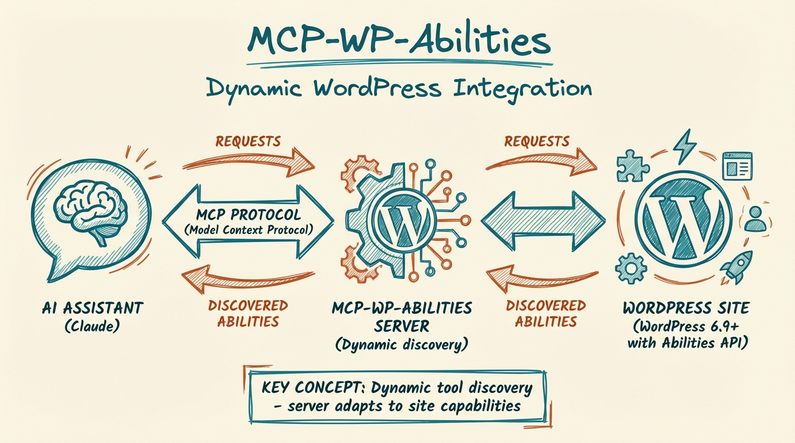

# MCP WordPress Abilities Server



[](https://www.npmjs.com/package/mcp-wp-abilities)
[](https://github.com/aplaceforallmystuff/mcp-wp-abilities/actions/workflows/ci.yml)
[](https://opensource.org/licenses/MIT)
[](https://modelcontextprotocol.io)

Your assistant needs access to the abilities your WordPress site and plugins register. This guide shows how to connect those abilities as tools.

Model Context Protocol (MCP) server (npm package `mcp-wp-abilities`) for the [WordPress 6.9+ Abilities API](https://developer.wordpress.org/news/2025/11/introducing-the-wordpress-abilities-api/). It discovers the abilities your WordPress site has registered and exposes each one to your AI assistant as an MCP tool.

## Why Use This?

- **Your site decides the tools** - Whatever abilities WordPress or your plugins register show up, with no tool list to maintain here
- **Ask in plain English** - Your assistant reads each ability's description and input schema and fills in the inputs from your request
- **Discover plugin abilities** - REST-enabled abilities appear automatically; callable names must follow the limits below
- **Permissions stay in WordPress** - Each ability runs as the WordPress user you configure, under that user's capabilities
- **Read-only abilities are marked** - The server tells the client which abilities are read-only, destructive or idempotent (safe to repeat without further changes), using the annotations the ability declares

## Features

| Feature | What it does |
|---------|--------------|
| Dynamic discovery | Fetches abilities from your site at runtime (cached for one minute) |
| Schema support | Passes each ability's JSON Schema input definition to the client |
| Method selection | GET for read-only abilities, POST for all others |
| Tool annotations | Maps ability annotations to `readOnlyHint`, `destructiveHint` and `idempotentHint` |
| Application Password auth | Authenticates with HTTP Basic auth using a WordPress Application Password |
| stdio transport | Runs as a local process that an MCP client such as Claude Desktop or Claude Code starts for you |

## Prerequisites

- Node.js 18 or later (the declared range is `>=18.0.0`; see the note below)
- A WordPress 6.9+ site with the Abilities API available
- A WordPress user with an [Application Password](#creating-a-wordpress-application-password)

**Node 18 note:** this release locks `@hono/node-server` 2.1.7 as a transitive dependency of the MCP SDK, and that package declares `node >=20`. A Node 18 install with `engine-strict` turned on may refuse to install it. The project's declared support range is unchanged, and Node 18 build and startup checks passed; the protocol tests were run on Node 26, with no live WordPress checks. If you hit the error, use Node 20 or later.

## Installation

### From npm

```bash
npm install -g mcp-wp-abilities
```

You can also skip the install and let your MCP client run the package with `npx`, as the configuration examples below do.

### From source

```bash
git clone https://github.com/aplaceforallmystuff/mcp-wp-abilities.git
cd mcp-wp-abilities
npm install
npm run build
```

The compiled server is `dist/index.js`.

## Configuration

The server needs three environment variables:

| Variable | Description |
|----------|-------------|
| `WORDPRESS_URL` | Your WordPress site URL (e.g., `https://example.com`) |
| `WORDPRESS_USERNAME` | WordPress username |
| `WORDPRESS_APP_PASSWORD` | Application Password (Users → Profile → Application Passwords) |

The examples below use placeholder values. Replace them with your own.

### Claude Desktop

Add to `~/Library/Application Support/Claude/claude_desktop_config.json` (macOS):

```json
{
  "mcpServers": {
    "wp-abilities": {
      "command": "npx",
      "args": ["-y", "mcp-wp-abilities"],
      "env": {
        "WORDPRESS_URL": "https://your-site.com",
        "WORDPRESS_USERNAME": "your-username",
        "WORDPRESS_APP_PASSWORD": "your-app-password"
      }
    }
  }
}
```

To run a source build instead, use `"command": "node"` and `"args": ["/absolute/path/to/mcp-wp-abilities/dist/index.js"]`.

### Claude Code

```bash
claude mcp add wp-abilities \
  -e WORDPRESS_URL="https://your-site.com" \
  -e WORDPRESS_USERNAME="your-username" \
  -e WORDPRESS_APP_PASSWORD="your-app-password" \
  -- npx -y mcp-wp-abilities
```

For a source build, replace the last line with `-- node /absolute/path/to/mcp-wp-abilities/dist/index.js`.

The server speaks MCP over stdio, so another MCP client that can start a local command with environment variables should be able to run it the same way. This README documents only the Claude clients above.

## Usage

Once connected, ask your assistant in plain language. What it can do depends on the abilities your site registers, so these prompts are examples:

- "What is the name and WordPress version of my site?"
- "Which PHP and database versions is my site running?"
- "What abilities does my WordPress site offer?"
- "Run the My Custom Ability tool from my plugin with param set to hello." (see the compatible example under Extending with Custom Abilities)

Your assistant sees each ability's description and input schema, so it can fill in arguments from your request. Abilities that change data are marked as destructive or not read-only when the ability declares it, which lets your client decide whether to ask you first.

## Available Tools

This server has no fixed tool list. It builds one from your site's abilities each time the client asks for the tool list.

**Naming:** the tool name is `wp_` plus the ability name, with every `/` and `-` replaced by `_`. The ability `core/get-site-info` becomes `wp_core_get_site_info`.

**Descriptions and inputs:** the description is `{label}: {description}` from the ability, and the input schema is the ability's own `input_schema` (an ability with no input gets an empty object schema).

**Examples:** the tools below are the kind of core abilities a WordPress 6.9 site offers. Treat them as site-dependent. The list on your site may differ, and plugins add more.

| Tool | Description |
|------|-------------|
| `wp_core_get_site_info` | Get site name, description, URL, version, language, etc. |
| `wp_core_get_environment_info` | Get PHP version, database info, environment type |

### Limitations

- The server requests the first 100 abilities (`per_page=100`) and does not page through more.
- Ability names such as `my-plugin/do-thing` cannot be called correctly. The part before `/` must contain no hyphens or underscores, and the part after `/` must contain no underscores. Tool calls turn the first underscore into `/` and all remaining underscores into hyphens, so names such as `core/get-site-info` work.
- The behavior above is checked against a local test server and the source only, not against a live WordPress site.

## How it Works

1. On startup, the server reads the three environment variables and waits for your MCP client over stdio
2. When the client lists tools, the server fetches the registered abilities with their schemas from `/wp-json/wp-abilities/v1` (cached for one minute)
3. Each ability is converted to an MCP tool with:
   - Name: `wp_` plus the ability name (e.g., `core/get-site-info` becomes `wp_core_get_site_info`)
   - Description: From the ability's label and description
   - Input schema: Converted from the WordPress JSON Schema
   - Annotations: `readOnlyHint`, `destructiveHint`, `idempotentHint`
4. When a tool is called, the server looks up the ability and executes it through its run endpoint

## Creating a WordPress Application Password

1. Log in to your WordPress admin
2. Go to **Users → Profile** (or the specific user's profile)
3. Scroll to **Application Passwords**
4. Enter a name (e.g., "MCP Server") and click **Add New Application Password**
5. Copy the generated password (shown only once)

## Security Notes

- Application Passwords grant API access as that user
- Use a dedicated user with minimal required capabilities
- Store credentials in environment variables or your client's secret storage, never in the repository
- The server does not modify WordPress itself, but the abilities it runs can change your site's data, with the permissions of the configured user

To report a vulnerability, see [SECURITY.md](SECURITY.md).

## Extending with Custom Abilities

WordPress plugins can register REST-enabled abilities that appear as MCP tools. Use names that follow the limits above:

```php
add_action( 'wp_abilities_api_init', function() {
    wp_register_ability( 'myplugin/my-ability', [
        'label'        => 'My Custom Ability',
        'description'  => 'Does something useful',
        'category'     => 'myplugin',
        'input_schema' => [
            'type'       => 'object',
            'properties' => [
                'param' => [ 'type' => 'string' ],
            ],
        ],
        'output_schema' => [
            'type'       => 'object',
            'properties' => [
                'result' => [ 'type' => 'string' ],
            ],
        ],
        'execute_callback'    => 'my_ability_handler',
        'permission_callback' => fn() => current_user_can( 'manage_options' ),
        'meta' => [
            'show_in_rest' => true,
            'annotations'  => [
                'readonly'    => false,
                'destructive' => false,
                'idempotent'  => true,
            ],
        ],
    ] );
} );
```

This ability would appear as `wp_myplugin_my_ability`.

## Development

```bash
npm run build   # Compile TypeScript to dist/
npm test        # Build, then run the MCP protocol tests
npm run dev     # Recompile on change (tsc --watch)
npm start       # Run the compiled server (needs the WordPress environment variables)
```

`npm test` starts the compiled server over stdio against a local test server that imitates the WordPress Abilities API. It needs no WordPress site or credentials and uses dummy values only. It checks the MCP handshake, tool listing and naming, a tool call, request authentication, and the error for missing environment variables.

Before sending a change, also run `npm audit --audit-level=high`.

## Troubleshooting

**"Missing required environment variables"**
- Ensure all three environment variables are set

**"Failed to discover abilities: 401"**
- Check username and Application Password are correct
- Verify the user has API access

**"Failed to discover abilities: 404"**
- Confirm your WordPress version is 6.9+
- Check that the Abilities API is enabled

**No tools appearing**
- Verify abilities are registered with `show_in_rest: true`
- Check the user has permission to access the abilities

**A tool call fails for a plugin ability**
- See the naming limitation under [Limitations](#limitations)

**Install fails on Node 18**
- See the Node 18 note under [Prerequisites](#prerequisites)

## Contributing

Contributions are welcome. See [CONTRIBUTING.md](CONTRIBUTING.md) for setup, development and pull request guidance.

## Changelog

See [CHANGELOG.md](CHANGELOG.md) for release history.

## License

MIT. See [LICENSE](LICENSE).

## Links

- [npm package](https://www.npmjs.com/package/mcp-wp-abilities)
- [GitHub repository](https://github.com/aplaceforallmystuff/mcp-wp-abilities)
- [WordPress Abilities API documentation](https://developer.wordpress.org/news/2025/11/introducing-the-wordpress-abilities-api/)
- [Model Context Protocol](https://modelcontextprotocol.io)
- [Author: Jim Christian](https://jimchristian.net)
